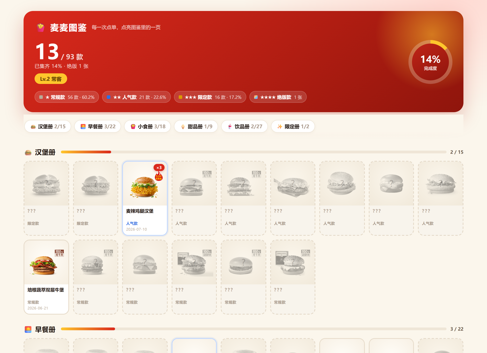
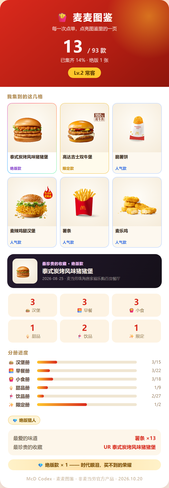
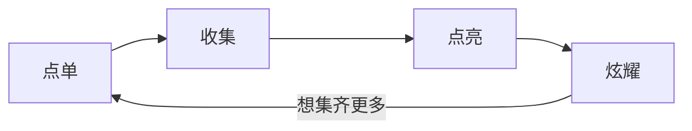
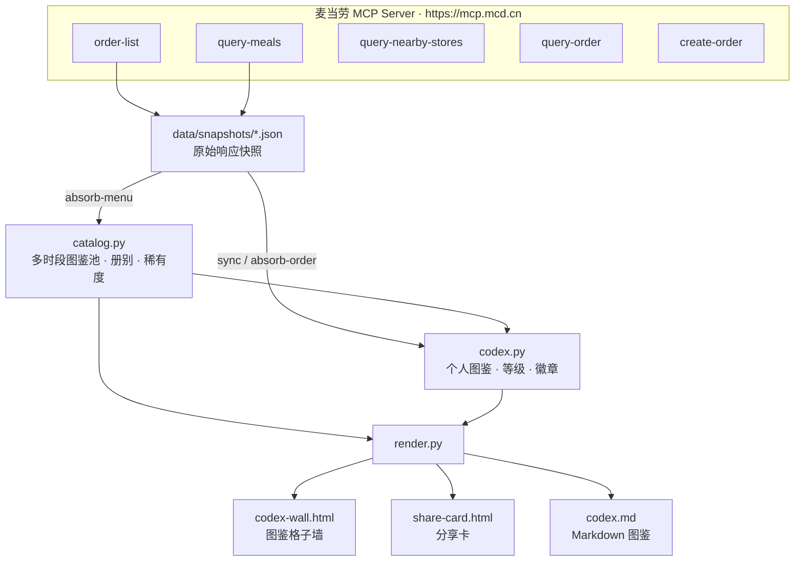

# 🍟 McD Codex · 麦麦图鉴

[](https://github.com/juziwa/mcd-codex/stargazers)
[](LICENSE)
[](https://www.python.org)
[](#快速开始)
[](#运行测试)
[](MCP_INTEGRATION.md)



> **每一次点单，点亮图鉴里的一页。**
>
> 你吃过多少款麦当劳？我猜你答不上来。

积分会过期，优惠券会用完，但那杯深夜的可乐、那支考试周的圆筒、那顿和朋友的八件套——它们值得被记住。

**McD Codex** 把你的麦当劳消费历史，变成一本**可收集、可炫耀、可回忆**的餐品图鉴：
六册图鉴铺成一面格子墙，点亮格是官方产品图，未点亮格是**灰度剪影 + `???`**；
曾经吃过、如今已下架的餐品会自动变成**全息绝版卡**。



---

## 30 秒看到它长什么样（零 Token）

不需要申请 MCP Token、不需要联网、不需要装任何依赖：

```bash
git clone https://github.com/juziwa/mcd-codex.git && cd mcd-codex
python scripts/demo.py --open
```

跑完会在 `demo/` 里生成一套完整产物，浏览器自动打开图鉴墙：

```
  🍟 麦麦图鉴 · 离线演示
  ----------------------------------------------
  图鉴池   93 款单品   R 56 / SR 21 / SSR 16
  已点亮   13 / 93（14%）  Lv.2 常客
  稀有度   UR 1 张（绝版） / SSR 1 / SR 7
  最珍贵   泰式炭烤风味猪猪堡（UR）
```

| 产物 | 说明 |
|---|---|
| `demo/wall.html` | **图鉴格子墙** —— 六册铺开，`???` 剪影 + 绝版殿堂 |
| `demo/card.html` | 分享卡 —— 我集到的这几格 + 最珍贵收藏 |
| `demo/codex.md` | Markdown 图鉴 —— GitHub 上直接看图 |

`demo/` 用的是仓库内 `examples/` 的脱敏快照（10 笔订单、两家门店 × 两个时段的菜单），
所以任何人都能复现出和你屏幕上一样的图。

> **为什么是两家门店**：单门店采样会把「别家门店在卖」的餐品误判成绝版。
> 实测中「培根蔬萃双层牛堡」在门店 A 的菜单里消失了，本该判 UR；
> 加入门店 B 的菜单后发现它仍在售，于是自动复活回常规款——
> 这就是文档里说的 UR 复活机制，真的会发生。

---

## 图鉴墙：把「图鉴」画出来，而不是打成报表

两家门店、四个时段采样回来 **208 个菜单编码**，其中 99 个是「二件套 / 三件套 /
随心选 / 分享餐」这类套餐，还有 2 款周边玩具和 1 款无名条目。它们会在采样时被
显式跳过——套餐本来就会被展开成单品收录，混进池里只会让同一个汉堡占两格、
让分母虚高。同名多编码（「派」「脆薯饼」）再合并，最终 **93 款单品**入册。
每一格都有五种状态：

| 状态 | 视觉 | 含义 |
|---|---|---|
| 常规款 `R` | 墨灰边框 | 常年菜单在售，你的日常 |
| 人气款 `SR` | 蓝色边框 | 招牌经典：巨无霸、薯条、麦乐鸡…… |
| 限定款 `SSR` | 金色边框 | 联名 / 主题 / 当季上新 |
| **绝版款 `UR`** | **全息描边** | 你吃过，但现在买不到了 |
| 未点亮 | **灰度剪影 + `???`** | 看得见轮廓，猜不到是谁 —— 想吃就去点亮它 |


### 稀有度：越稀有越少

收集玩法的地基是**梯度**。旧版把「仅早餐时段供应」直接判成 `SSR`，
结果早餐册 55 款 100% 是「限定款金色」、SSR 占全池 55%（比常规款还多）——
稀缺感归零。v2 改为按「限定属性」而不是「供应时段」分层：

| 档位 | 规则 | 池内实测 |
|:---:|---|---:|
| `R` 常规款 | 其余常规在售单品 | **56 款 · 60%** |
| `SR` 人气款 | 招牌经典款（精确名单）或官方「人气」标签 | **21 款 · 23%** |
| `SSR` 限定款 | 名称含联名/主题限定词，或标签含「上新 / 限定」 | **16 款 · 17%** |
| `UR` 绝版款 | 历史吃过，但当前**所有已采样门店**的菜单里都没有 | 由订单决定（示例 1 张） |

> 示例里的 16 款 SSR 是真实在售的新品季阵容（龙焰系列、蘸酱炸鸡、北非蛋麦满分、
> 高达 / 泷联名），不是「因为早餐只在早上卖」被凑出来的。

> 「限定特惠」是**打折**，不是限定商品 —— 这一条也曾让 4 款常年供应的麦咖啡
> 被误标为限定，v2 一并修掉。稀有度判定的回归测试见
> `tests/test_codex.py::TestRarityBalance`。

### 六册图鉴

🍔 汉堡册 15 · 🌅 早餐册 22 · 🍟 小食册 18 · 🍦 甜品册 9 · 🥤 饮品册 27 · ✨ 限定册 2

按真实菜单分类 + 名称兜底归类；同一餐品有多个菜单编码时合并为一格
（「派」「脆薯饼」都曾因此重复占两格）。

---

## 它是什么

一个基于**麦当劳官方 MCP Server** 的收集型 Skill（配合 WorkBuddy / Claude Desktop 等支持 MCP 的智能体使用），
核心循环只有三步：



- **收集**：订单完成后，把订单里的**单品级**餐品（组合餐自动展开到子项）收入图鉴
- **点亮**：六册归类、四档稀有度、等级称号、8 枚特质徽章
- **炫耀**：一张分享卡 + 一面格子墙，晒到群里，朋友问「哪来的」

### 等级 / 称号 / 徽章

从「麦门新客」到「麦门图鉴大师」，8 枚特质徽章：绝版猎人 / 环游麦门 / 暴走探索者 /
早餐战神 / 薯条之王 / 甜品控 / 限定收藏家 / 汉堡猎人。

---

## 快速开始

### 1 · 配置麦当劳 MCP

申请 Token：<https://open.mcd.cn/mcp>，然后按 `mcp-config.example.json`
配置你的 MCP 客户端（WorkBuddy / Claude Desktop 等）：

```json
{
  "mcpServers": {
    "mcd-mcp": {
      "type": "streamablehttp",
      "url": "https://mcp.mcd.cn",
      "headers": { "Authorization": "Bearer ${MCD_MCP_TOKEN}" }
    }
  }
}
```

`${MCD_MCP_TOKEN}` 只是占位符。请在本地 MCP 客户端按其文档配置环境变量，
或只在本地配置文件中替换为你申请的 Token；**不要把真实 Token 写入仓库或对话**。

### 2 · 安装 Skill

```bash
git clone https://github.com/juziwa/mcd-codex.git
cp -r mcd-codex ~/.workbuddy/skills/mcd-codex
```

Windows PowerShell：

```powershell
git clone https://github.com/juziwa/mcd-codex.git
Copy-Item -Recurse -Force .\mcd-codex "$HOME\.workbuddy\skills\mcd-codex"
```

### 3 · 打开图鉴

对智能体说：

> 打开我的麦麦图鉴

首次打开会自动补录最近订单——「发现你的 X 款历史足迹，图鉴已激活！」。
菜单池缺失时会先采样当前门店，保证不是空壳，开册即有收获。

### 4 · 命令行直接用

```bash
# 合并双时段菜单快照进图鉴池（事务式: 任一快照无效则保留旧池）
python scripts/codex.py absorb-menu --menu data/snapshots/menu-regular.json \
  --breakfast-menu data/snapshots/menu-breakfast.json \
  --catalog data/catalog.json --period regular --store 1440001

# 补录订单 + 重判稀有度（--probe-images 会给绝版款补官方图，需联网）
python scripts/codex.py sync --orders data/snapshots/order-list.json \
  --codex data/codex.json --catalog data/catalog.json --probe-images

# 渲染三种交付物
python scripts/codex.py render --codex data/codex.json --catalog data/catalog.json
```

纯 Python 标准库实现，**零第三方依赖**。

### 5 · 运行测试

```bash
python -m unittest discover -s tests -v
```

113 个测试覆盖：归一化 / 稀有度梯度 / 册别归类 / 三通道匹配 / 收录幂等 /
取消单 / 空数据 / 无池降级 / UR 复活（含多门店并集复活）/ 套餐过滤 /
格子墙渲染 / Markdown 进度条 / 绝版补图 / 离线 Demo。
测试报告见 [docs/test-report.md](docs/test-report.md)。

---

## 架构



## 目录结构

```
mcd-codex/
├── README.md                    # 项目介绍（本文件）
├── SKILL.md                     # Skill 编排定义（智能体按此执行）
├── MCP_INTEGRATION.md           # MCP Server / Tool / 调用流程 / 业务价值
├── CONTEST_DECLARATION.md       # 参赛声明（官方原版，未改动）
├── mcp-config.example.json      # 脱敏 MCP 配置示例（仅环境变量占位符）
├── workbuddy.md                 # WorkBuddy 协作上下文
├── scripts/                     # 核心引擎（纯标准库）
│   ├── rarity.py                #   名称归一化 + 稀有度判定
│   ├── catalog.py               #   多时段图鉴池 + 册别归类 + 套餐过滤
│   ├── codex.py                 #   收录引擎 CLI（含绝版补图）
│   ├── render.py                #   格子墙 / 分享卡 / Markdown 渲染
│   └── demo.py                  #   零 Token 离线演示
├── assets/
│   ├── templates/               #   codex-wall.html / share-card.html 模板
│   └── preview/                 #   README 预览图（真实渲染截图）
├── docs/                        # 设计文档 + 测试报告
├── tests/                       # 单元 / 集成 / 边界 / 回归测试（113 个）
└── examples/                    # 脱敏示例数据（可离线复现）
```

> `data/`、`output/`、`demo/` 是本地产物目录（含个人消费记录），已在 `.gitignore` 中排除。

## MCP 集成

本项目**真实调用**麦当劳 MCP Server（`https://mcp.mcd.cn`），图鉴核心使用 5 个 Tool：

`order-list` · `query-meals` · `query-nearby-stores` · `query-meal-detail` · `query-order`

菜单采样与真实下单流程还会按需使用 `now-time-info`、`calculate-price` 和 `create-order`。
调用 `create-order` 前必须展示门店、商品、数量和金额，并取得用户对本次订单的明确确认。

详细调用链路与业务价值见 **[MCP_INTEGRATION.md](MCP_INTEGRATION.md)**，
Skill 编排定义见 [SKILL.md](SKILL.md)。

## 它和别的点餐工具不一样

榜单上的项目大多在帮你**省钱、选餐、规划**——工具理性。
McD Codex 是唯一把用户当**玩家**而不是顾客的：

| 维度 | 工具型项目 | McD Codex |
|---|---|---|
| 心智 | 用完即走的工具 | 越用越厚的图鉴 |
| 资产 | 无 | 图鉴 / 等级 / 徽章 / 绝版卡 |
| 情感 | 无 | 回忆、收集欲、炫耀 |
| 传播 | 弱 | 晒图是刚需 |

麦当劳本就是全球最早的「收集机制」玩家——开心乐园餐玩具、限定杯、联名周边。
McD Codex 做的，是把这套线下收集文化搬进数字世界。

## 目标用户

- **麦门常客**（每周 1-2 次+）：真实使用，形成习惯
- **收集爱好者**（图鉴党 / 盲盒党 / 成就党）：高黏性，主动传播
- **爱晒图的社交用户**：分享卡自带传播闭环

## 路线图

- [x] 双通道点亮（主动收录 + 增量补录）
- [x] 绝版款（UR）自动检测与复活机制
- [x] 等级 / 称号 / 8 枚徽章
- [x] **图鉴格子墙**（官方产品图 + 剪影 + 全息绝版卡）
- [x] **稀有度梯度重构**（R 63% / SR 26% / SSR 11%）
- [x] **套餐过滤**（图鉴只收集单品，分母不再被 N 件套稀释）
- [x] **零 Token 离线 Demo**（`python scripts/demo.py`）
- [ ] 营养信息扩展（`list-nutrition-foods`，卡片显示热量）
- [ ] 年度麦门报告（你的一月最爱 / 足迹地图）
- [ ] 多城市采样，区域限定品补全图鉴池

## v2 更新（2026-10）

| 问题 | 修法 |
|---|---|
| 早餐时段被判 SSR，SSR 占全池 55% | 稀有度按「限定属性」分层，SSR 降到 17% |
| 单门店采样导致误判绝版（培根蔬萃双层牛堡） | 多门店菜单取并集，UR 复活回常规款 |
| 「限定特惠」打折误判限定 | 促销标签白名单剔除 |
| 套餐混进图鉴池，分母虚高（208 编码 → 93 单品） | 图鉴只收单品，套餐采样即跳过 |
| 同名多编码重复占格（派 / 脆薯饼） | 归一化名称合并 |
| 图鉴只有数字与进度条 | 新增图鉴格子墙（官方图 + 剪影 + 绝版殿堂） |
| 分享卡看不到任何餐品 | 分享卡加入「我集到的这几格」+ 收藏特写 |
| 绝版款没有图 | 按商品编码回查官方图 CDN（HEAD 校验后才写入） |
| `??？` 混排 / 进度条 5% 显示为空 | 统一 `???`，进度条支持 1/8 格细分 |
| 路人无法 30 秒看到效果 | `scripts/demo.py` 零 Token 一键出图 |

## 合规说明

- 本项目为麦当劳程序员节创意开发大赛参赛作品，由参赛者独立开发，**非麦当劳官方产品**
- 参赛声明见 [CONTEST_DECLARATION.md](CONTEST_DECLARATION.md)（官方原版，内容未改动）
- 图鉴数据仅保存在用户本地；仓库中不含任何真实 Token / 个人凭证
- 餐品信息、价格及供应状态以麦当劳官方渠道实时结果为准
- 产品图版权归麦当劳所有，仅用于展示用户自己点过的餐品

## License

[MIT](LICENSE)
